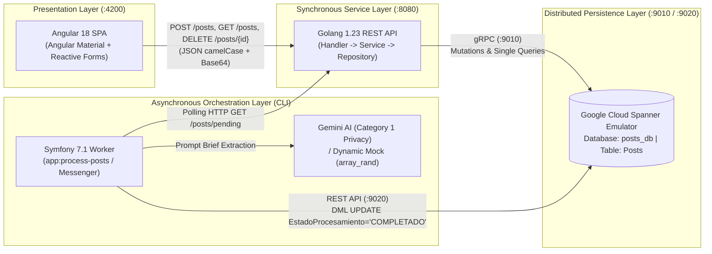

# System Architecture Design

## 1. Architectural Principles

The platform is engineered around three core architectural pillars:
1. **Strict Separation of Concerns (SoC):** Each microservice operates strictly within its technical boundary. The Go HTTP server does not execute heavy background jobs; the Symfony worker does not expose public business endpoints; and the Angular SPA performs search filtering locally in browser memory.
2. **Resilience & Low-Latency Critical Path:** High-latency external operations (LLM inference via the Gemini API and binary uploads to Google Drive) are completely decoupled from the user-facing HTTP request-response cycle.
3. **Strict Stack Adherence:** No unauthorized middleware (such as Redis, RabbitMQ, PostgreSQL, or MySQL) is introduced. State coordination is managed directly within **Google Cloud Spanner** via the `EstadoProcesamiento` column.

---

## 2. Component Architecture Diagram



---

## 3. Technical Breakdown by Layer

### 3.1. Golang Backend REST API (`/backend`)
Inspired by **Google Borg** microservice standards, the Go backend follows a clean internal layered structure (`internal/domain`, `internal/repository`, `internal/service`, `internal/handler`):

- **Single Responsibility:** Serve `camelCase` JSON REST endpoints with minimal latency on port `8080` ([see REST API Contracts](../api/api-contracts.md)).
- **No Internal Business Goroutines or Workers:** Go delegates 100% of deferred processing by persisting every new Post with `EstadoProcesamiento = 'PENDIENTE'`.
- **12-Factor App Configuration:** Uses `github.com/joho/godotenv` and environment variables (`PORT`, `SPANNER_DSN`, `SPANNER_EMULATOR_HOST`) to decouple source code from deployment topology.
- **Null-Safe Spanner Scanning:** The repository layer uses `spanner.NullString` to scan nullable columns (`Descripcion`, `Adjunto`, `DatosExtraidosIA`, `EstadoProcesamiento`), preventing deserialization errors when fields have not yet been populated by the orchestrator.

### 3.2. Database: Google Cloud Spanner (`/database`)
- **Hot-Spotting Prevention:** In distributed databases such as Cloud Spanner, sequential primary keys (`AUTO_INCREMENT`) route all concurrent writes to a single node (*split*). Therefore, the `Id STRING(36)` primary key uses a **UUIDv4** generated in the Go service layer, evenly distributing writes across the cluster ([see DDL & Data Dictionary](../database/data-dictionary.md)).
- **`Posts` Table DDL Schema:**
  ```sql
  CREATE TABLE Posts (
      Id STRING(36) NOT NULL,
      Nombre STRING(255) NOT NULL,
      Descripcion STRING(MAX),
      Adjunto STRING(MAX),
      DatosExtraidosIA STRING(MAX),
      EstadoProcesamiento STRING(50)
  ) PRIMARY KEY (Id);
  ```

### 3.3. Symfony Workflow Orchestrator (`/orchestrator`)
The Symfony microservice implements the asynchronous background processing pattern (**OneStack Workflows**, detailed in [Asynchronous Workflows Specification](../workflows/async-orchestration.md)):

- **Decoupled Polling Mechanism (`app:process-posts`):** Because Cloud Spanner serves as the single source of truth under the *Strict Stack*, `ProcessPendingPostsCommand` periodically queries `GET /posts/pending` on the Go backend and dispatches `ProcessPostAiBrief` messages to `ProcessPostAiBriefHandler`.
- **Gemini API Integration (Category 1 Privacy Setup):**
  - In production, the handler injects enterprise data-governance headers (`X-Goog-Vertex-Data-Governance: category-1-no-train`, `X-Goog-Privacy-Disable-Training: true`, `X-Goog-Privacy-Zero-Retention: true`), ensuring confidential campaign briefs are never retained or used to train foundation models.
  - In local development (when `GEMINI_API_KEY` is omitted), it executes a **dynamic random generator** (`array_rand`) that combines 5 realistic campaign objectives and 5 B2B/B2C target audiences on each iteration.
- **Transactional State Update:** Once AI extraction completes, Symfony runs a `ReadWrite` transaction against the Cloud Spanner REST API (`:beginTransaction` -> `:executeSql` -> `:commit`):
  ```sql
  UPDATE Posts
  SET DatosExtraidosIA = @datosExtraidosIA,
      EstadoProcesamiento = 'COMPLETADO'
  WHERE Id = @postId
  ```

### 3.4. Angular + Material Frontend SPA (`/frontend`)
- **Standalone Architecture & Routing:**
  - `/`: `HomeComponent` displaying the welcome screen for the TCIT technical test.
  - `/posts`: `PostListComponent` featuring an Angular Material table (`MatTable`), visual status badges (`PENDIENTE` / `COMPLETADO`), attachment links, AI extraction results, and row actions (`Edit`, `Delete`).
  - `/posts/new` and `/posts/:id/edit`: `PostFormComponent` using Angular Reactive Forms (`FormGroup`) with strict validators (`Validators.required`, `Validators.maxLength(300)`) on `Campaign Name`, `Description`, and `Campaign Brief`.
- **Client-Side Base64 Encoding:** When a user selects a file, Angular uses `FileReader.readAsDataURL()` to convert it into a Base64 Data URL and embeds it directly inside the single `POST /posts` JSON payload.
- **Single Fetch & In-Memory Filtering:** The list view invokes `GET /posts` once during `ngOnInit()`. The `PostFilterComponent` filters campaigns by name directly in browser memory without triggering redundant HTTP requests.

---

## 4. Mocked Data, Simulated Connections & Production Transition

> **⚠️ PRODUCTION ALERT: MOCKED DATA & PENDING INTEGRATIONS**
>
> To allow local execution without paid cloud accounts or external API credentials, the following components are currently mocked or emulated:
> 1. **Google Cloud Spanner Emulator (`database/docker-compose.yml`):** Connects via `SPANNER_EMULATOR_HOST=localhost:9010` (Go) and `http://localhost:9020` (Symfony) without IAM Service Account authentication.
> 2. **Gemini AI Dynamic Mock (`orchestrator/src/MessageHandler/ProcessPostAiBriefHandler.php`):** Because `GEMINI_API_KEY` is empty in `orchestrator/.env`, the worker generates random combinations of 5 campaign objectives and 5 target audiences using `array_rand()`.
> 3. **Attachment Persistence (`Posts.Adjunto`):** Stores browser-generated Base64 Data URLs directly in Cloud Spanner instead of uploading binaries to a live Google Drive bucket.
> 4. **Development Secrets & Endpoints:** Uses a static `APP_SECRET` in Symfony, wildcard CORS (`*`) in Go, and `http://localhost:8080/posts` in Angular.
>
> 👉 **For the complete component inventory and step-by-step production remediation instructions, see [`docs/MOCKED_DATA_ALERTS.md`](../MOCKED_DATA_ALERTS.md).**
