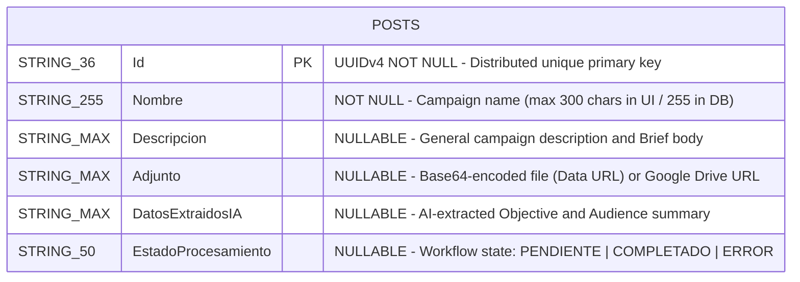

# Database Schema (DDL) & Data Dictionary

This document specifies the physical and logical database design in **Google Cloud Spanner** for the Campaigns & Briefs Management Platform (TCIT), including official DDL statements, the detailed data dictionary, domain constraints, and transactional access patterns.

---

## 1. Instance & Database Configuration (Local Environment)

In the local development environment, persistence runs on the official **Google Cloud Spanner Emulator** container (`gcr.io/cloud-spanner-emulator/emulator:latest`).

| Parameter | Configured Value | Description |
| :--- | :--- | :--- |
| **Project ID** | `mi-proyecto-local` | GCP Project identifier inside the local emulator. |
| **Instance ID** | `mi-instancia-local` | Cloud Spanner instance automatically provisioned on Docker startup. |
| **Database ID** | `posts_db` | Relational database hosting the application schema. |
| **Full DSN** | `projects/mi-proyecto-local/instances/mi-instancia-local/databases/posts_db` | Connection string used by the Golang SDK and the Symfony REST client. |
| **gRPC Port** | `localhost:9010` | High-performance gRPC endpoint consumed by the Golang Backend microservice. |
| **REST Port** | `http://localhost:9020` | HTTP/JSON endpoint consumed by the initialization container and the Symfony Worker. |

---

## 2. Entity-Relationship Diagram (Mermaid ER)



---

## 3. DDL Statements (Data Definition Language)

### 3.1. Initial Table Creation Script (`schema.sql`)

```sql
CREATE TABLE Posts (
    Id STRING(36) NOT NULL,
    Nombre STRING(255) NOT NULL,
    Descripcion STRING(MAX),
    Adjunto STRING(MAX),
    DatosExtraidosIA STRING(MAX),
    EstadoProcesamiento STRING(50)
) PRIMARY KEY (Id);
```

### 3.2. Live Incremental Migration (`ALTER TABLE`)

For environments where the `Posts` table was initially provisioned without the asynchronous workflow control column:

```sql
ALTER TABLE Posts ADD COLUMN EstadoProcesamiento STRING(50);
```

---

## 4. Detailed Data Dictionary: `Posts` Table

The `Posts` table stores the complete lifecycle of a marketing campaign or creative brief, from initial capture in the Angular SPA to asynchronous AI enrichment in the Symfony Orchestrator.

| Column (Spanner) | Data Type (DDL) | Nullability | JSON Property (API) | Go Type (`domain` / `repo`) | Default Value on Creation | Functional Description & Business Rules |
| :--- | :--- | :--- | :--- | :--- | :--- | :--- |
| **`Id`** | `STRING(36)` | `NOT NULL` (`PK`) | `id` | `string` | `UUIDv4` (generated in Go) | **Primary Key.** Version 4 Universally Unique Identifier (e.g., `550e8400-e29b-41d4-a716-446655440000`). Prevents write hot-spotting across Cloud Spanner splits. |
| **`Nombre`** | `STRING(255)` | `NOT NULL` | `nombre` | `string` | User-provided value | **Campaign Name.** Required in both the Frontend (`Validators.required`, `Validators.maxLength(300)`) and the Go domain service (`strings.TrimSpace(post.Nombre) != ""`). |
| **`Descripcion`** | `STRING(MAX)` | `NULL` | `descripcion` | `string` / `spanner.NullString` | Description + Brief | **Campaign Description & Brief.** Required in the Angular form (up to 300 characters per input field). Stores the text context analyzed by the AI worker. |
| **`Adjunto`** | `STRING(MAX)` | `NULL` | `adjunto` | `string` / `spanner.NullString` | Base64 string or `""` | **Supporting Attachment.** Stores the browser-encoded Base64 Data URL (`data:<mime>;base64,...`) or the resulting Google Drive document URL. |
| **`DatosExtraidosIA`** | `STRING(MAX)` | `NULL` | `datosExtraidosIA` | `string` / `spanner.NullString` | `""` (empty string) | **AI Extraction Output.** Asynchronously populated by the Symfony worker after analyzing the brief (e.g., `"Objetivo: Generar leads cualificados B2B \| Audiencia: Directores de tecnología (CTOs) en LATAM"`). |
| **`EstadoProcesamiento`** | `STRING(50)` | `NULL` | `estadoProcesamiento` | `string` / `spanner.NullString` | `'PENDIENTE'` | **Asynchronous Workflow State.** Acts as the coordination semaphore between the Go Backend and the Symfony Orchestrator. Allowed values: `'PENDIENTE'`, `'COMPLETADO'`, `'ERROR'`. |

---

## 5. Constraints, Domain Values & Cloud Spanner Design Decisions

### 5.1. Preventing Hot-Spotting with `UUIDv4`
In **Google Cloud Spanner**, rows are ordered lexicographically by their primary key (`PRIMARY KEY (Id)`) and partitioned into contiguous key ranges called *splits* distributed across storage nodes.
- **Anti-pattern avoided:** Sequential keys (`INT64` auto-increment or leading timestamps) funnel 100% of concurrent inserts into the last *split*, creating a single-node bottleneck (*hot-spot*).
- **Implemented solution:** The Go service layer generates a random 36-character `UUIDv4` (`github.com/google/uuid`) prior to each insertion, guaranteeing uniform write distribution across the cluster.

### 5.2. Null-Safe Scanning (`spanner.NullString`)
Because `Descripcion`, `Adjunto`, `DatosExtraidosIA`, and `EstadoProcesamiento` are nullable in the DDL schema (`NULL`), the Go repository (`internal/repository/spanner_repository.go`) scans rows using `spanner.NullString` (`row.Columns(...)`). When `Valid == true`, `StringVal` is extracted; otherwise, it normalizes to `""` (or `"PENDIENTE"` for `EstadoProcesamiento`), preventing runtime null-pointer errors on legacy or partially populated records.

### 5.3. `EstadoProcesamiento` Domain Values

| Status Value | Producer | Meaning | System Behavior |
| :--- | :--- | :--- | :--- |
| **`PENDIENTE`** | Golang Backend (`POST /posts`) | Record has been created and is awaiting background AI processing. | Returned by `GET /posts/pending` for consumption by the Symfony worker. Rendered with an amber/yellow status badge in Angular. |
| **`COMPLETADO`** | Symfony Orchestrator (`app:process-posts`) | Worker processed the brief via Gemini/Mock and stored the output in `DatosExtraidosIA`. | Excluded from `GET /posts/pending`. Rendered with a green status badge in Angular along with the `DatosExtraidosIA` text. |
| **`ERROR`** | Symfony Orchestrator | Unrecoverable failure during workflow execution after exhausting retry attempts. | Enables operational auditing without blocking other pending records in the queue. |

---

## 6. SQL / DML Operation Matrix by Microservice

| Operation | Microservice | Method / Command | SQL Statement or Spanner Mutation | Transaction Type |
| :--- | :--- | :--- | :--- | :--- |
| **Insert Post** | Backend (Go) | `CrearPost` | `spanner.Insert("Posts", cols, vals)` | `ReadWriteTransaction` (Atomic mutation) |
| **List All Posts** | Backend (Go) | `ListarPosts` | `SELECT Id, Nombre, Descripcion, Adjunto, DatosExtraidosIA, EstadoProcesamiento FROM Posts` | `Single()` (Lock-free read) |
| **List Pending Posts** | Backend (Go) | `ListarPostsPendientes` | `SELECT Id, Nombre, Descripcion, Adjunto, DatosExtraidosIA, EstadoProcesamiento FROM Posts WHERE EstadoProcesamiento = 'PENDIENTE'` | `Single()` (Lock-free read) |
| **Update AI Output** | Orchestrator (Symfony) | `ProcessPostAiBriefHandler` | `UPDATE Posts SET DatosExtraidosIA = @datosExtraidosIA, EstadoProcesamiento = 'COMPLETADO' WHERE Id = @postId` | `ReadWrite` via Spanner REST API (`:executeSql` + `:commit`) |
| **Delete Post** | Backend (Go) | `EliminarPost` | `row, err := txn.ReadRow(...)` followed by `spanner.Delete("Posts", spanner.Key{id})` | `ReadWriteTransaction` (Existence check + delete) |
