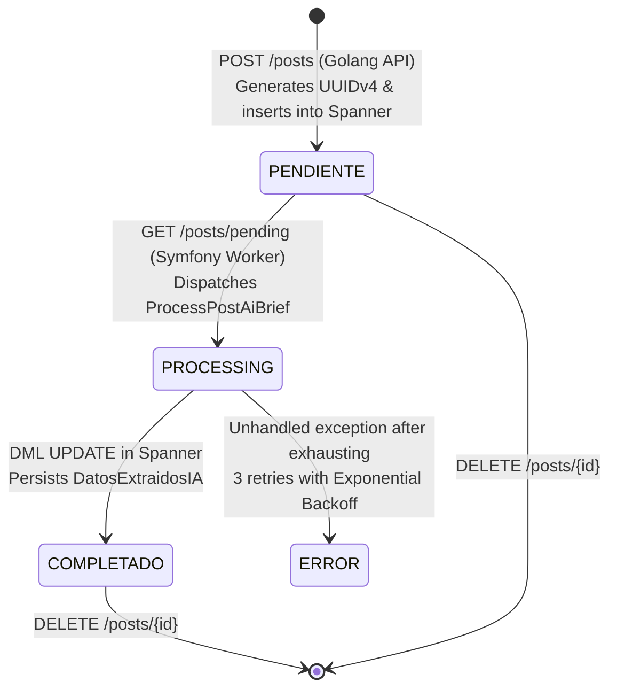
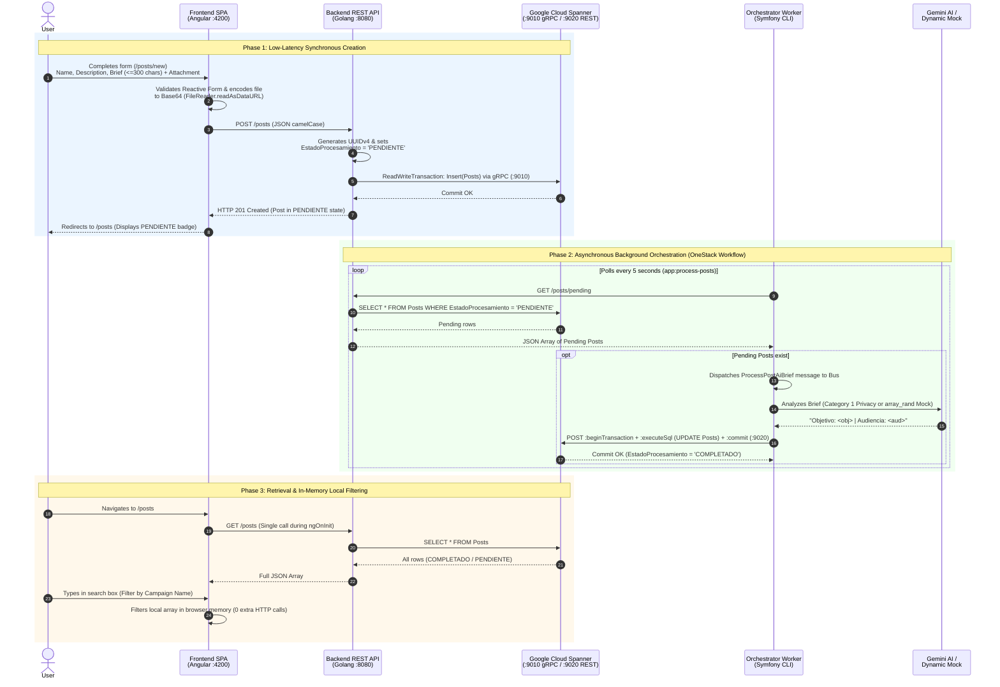

# Asynchronous Workflows & State Machine Specification

This document details the End-to-End (*E2E*) execution flows, the asynchronous processing state machine, and the Artificial Intelligence integration rules (**Gemini API Category 1 Privacy** and **Dynamic Random Mock**).

---

## 1. Post Lifecycle State Machine (`EstadoProcesamiento`)

Every record in the `Posts` table follows a deterministic lifecycle governed by the `EstadoProcesamiento` column:



---

## 2. End-to-End Sequence Diagram

The following sequence diagram illustrates the chronological interactions across the User, the Angular SPA (`:4200`), the Golang REST API (`:8080`), the Cloud Spanner Emulator (`:9010` / `:9020`), and the Symfony CLI Worker (`app:process-posts`):



---

## 3. AI Extraction Engine Specification in Symfony

The `ProcessPostAiBriefHandler` (`orchestrator/src/MessageHandler/ProcessPostAiBriefHandler.php`) operates in two modes depending on the environment configuration:

### 3.1. Production Mode (`GEMINI_API_KEY` configured)
Sends an HTTP `POST` request to `https://generativelanguage.googleapis.com/v1beta/models/gemini-2.5-flash:generateContent` injecting mandatory enterprise data-governance headers (**Category 1 Privacy Setup**):

| HTTP Header | Value | Purpose |
| :--- | :--- | :--- |
| `X-Goog-Vertex-Data-Governance` | `category-1-no-train` | Prohibits using the payload for foundation model training or fine-tuning. |
| `X-Goog-Privacy-Disable-Training` | `true` | Disables prompt ingestion into product improvement pipelines. |
| `X-Goog-Privacy-Zero-Retention` | `true` | Enforces zero cache retention after inference completes. |

### 3.2. Local Development Mode (Dynamic Mock via `array_rand`)
When running locally with simulated AI integration (or without an API key), the worker randomly selects a realistic campaign objective and target audience on every execution using `array_rand()`:

- **Campaign Objectives Catalog (5 options):**
  1. `"Aumentar el brand awareness en un 20%"` *(Increase brand awareness by 20%)*
  2. `"Generar leads cualificados B2B"` *(Generate qualified B2B leads)*
  3. `"Impulsar ventas del e-commerce en Q3"` *(Boost Q3 e-commerce sales)*
  4. `"Lanzamiento de nuevo producto"` *(New product launch)*
  5. `"Retención y fidelización de usuarios activos"` *(Active user retention and loyalty)*
- **Target Audiences Catalog (5 options):**
  1. `"Jóvenes 18-24 años segmento gamer"` *(Youth aged 18–24, gaming segment)*
  2. `"Directores de tecnología (CTOs) en LATAM"` *(Chief Technology Officers in LATAM)*
  3. `"Público general urbano 25-45 años"` *(General urban audience aged 25–45)*
  4. `"Pequeñas y medianas empresas (PyMEs)"` *(Small and medium-sized enterprises - SMEs)*
  5. `"Compradores compulsivos de tecnología"` *(Tech early adopters and frequent buyers)*

**Output format persisted in `DatosExtraidosIA`:**
```text
Objetivo: <Random Objective> | Audiencia: <Random Audience>
```

---

## 4. Frontend Validation & Base64 Encoding Flow (`/frontend`)

The `PostFormComponent` enforces data integrity prior to invoking the Backend API:

1. **Reactive Form Validations (`Validators`):**
   - `nombre` (*Campaign Name*): `[Validators.required, Validators.maxLength(300)]`
   - `descripcion` (*Description*): `[Validators.required, Validators.maxLength(300)]`
   - `brief` (*Campaign Brief*): `[Validators.required, Validators.maxLength(300)]`
2. **Visual Feedback (`Angular Material`):**
   - Live character counters (`{{ control.value?.length || 0 }}/300`) rendered via `<mat-hint align="end">`.
   - Dedicated `<mat-error>` messages for both `required` and `maxlength` violations.
   - Submit button dynamically disabled via `[disabled]="form.invalid || enviando"`.
3. **Client-Side Base64 Packaging:**
   - Upon selecting a file in the browser, `FileReader.readAsDataURL(file)` encodes the binary into a Base64 Data URL and embeds it directly into the single `POST /posts` JSON request, avoiding intermediate upload endpoints.
